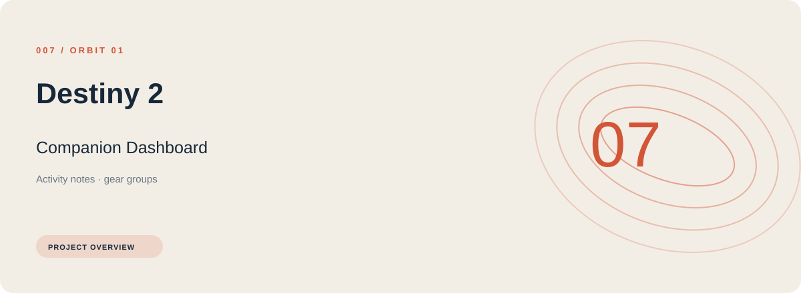
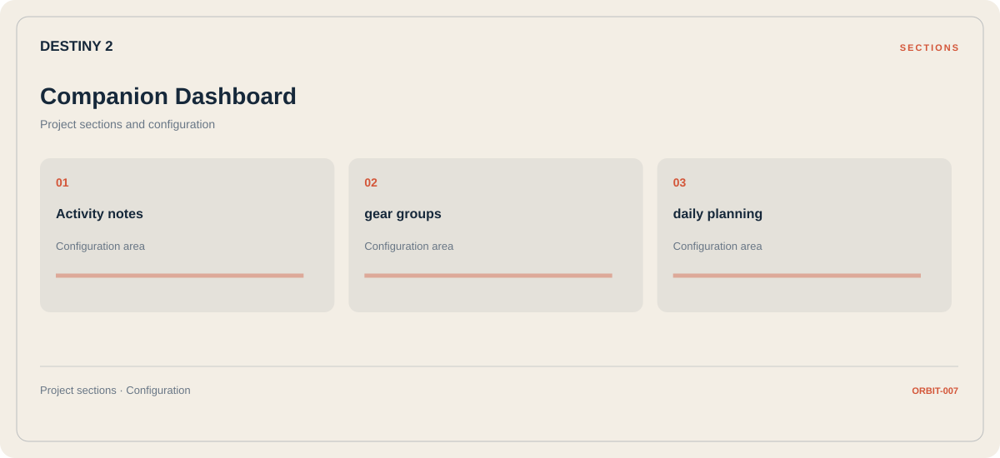

# 🧭 Destiny 2 Companion Dashboard

**Activity notes · Gear groups · Daily planning**

## ⚡ Features

The Destiny 2 companion dashboard workflow separates activity notes from gear groups and daily planning. Named sections make the available options easier to find.

### ⚙️ Activity notes

Session and activity information grouped by the task or context it belongs to.

### 🧩 Gear groups

Equipment categories and the associated selection or configuration options.

### ⌨️ Daily planning

A dedicated section for daily planning and the configuration details associated with that area.

## 🖥️ Project navigation

## 📥 Download

The button and cover open the project's download page. Use the information supplied with the downloaded package for installation and release-specific requirements.

## 📚 Project documentation

- [Feature reference](docs/FEATURES.md)
- [Download information](docs/DOWNLOAD.md)
- [Project page](index.html)

---

Destiny 2 Companion Dashboard · Program documentation and download information.
                                                                                                    